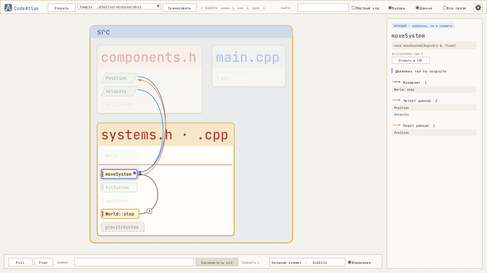

# CodeAtlas

Карта C++ кода и шейдеров GLSL: функции, вызовы и данные на постоянной раскладке, строится через clang и листается по снимкам истории.



## Что показывает

- Блок - функция (тело не расписывается), тип, компонент или событие. Функции и типы файла стоят в рамке файла, рамки - в областях папок.
- Шейдеры GLSL: функции и вызовы между ними (через `#include`), `main` проходов одного файла по веткам `#ifdef`; из C++ - связь к `main` шейдера от функции, которая собирает программу, и от функций, которые её запускают.
- Щелчок по блоку - его связи: вызовы (серые, с номером по порядку в теле), чтение данных (синие) и запись (оранжевые); справа - сигнатура, файл и строка, комментарий над объявлением и списки связей.
- Раскладка постоянная: места блоков хранятся у CodeAtlas (в проект он ничего не пишет), новые блоки встают в свой файл или рядом со своей папкой, старые не двигаются. Блоки, файлы (за полосу имени) и папки (за полосу имени) переставляются руками, на холст ставятся пометки.
- История: каждое сканирование снимает граф на текущем коммите (повтор на том же коммите заменяет снимок). Ползунок внизу листает снимки, «Изменения» подсвечивают новое (зелёным), изменённое (жёлтым) и удалённое (пунктир на старом месте).

Всё проектное (компоненты и события ECS и т.п.) задаётся в шаблоне проекта `codeatlas.yaml` - см. [docs/PROJECT_TEMPLATE.md](docs/PROJECT_TEMPLATE.md).

## Управление

- Колесо - масштаб у курсора; тащить пустое место (или средней кнопкой) - сдвиг вида
- Щелчок по блоку - выбор, двойной - приблизить; Esc - снять выбор, F - вся карта
- Тащить блок, полосу имени файла или папки - переставить: соседи расступаются с зазором и возвращаются, когда перетаскиваемое ушло; Ctrl+Z - отменить. Налезшее друг на друга при открытии (выросли файлы, сменились размеры) раздвигается вправо и вниз
- Карта масштабируется целиком, как одна картинка: имена папок, файлов и блоков - размером холста и не пропадают при отдалении
- Высота блока функции - по числу строк определения: ступенями по логарифму (по умолчанию), по строкам или одна у всех (настройки «Высота функции» и «Строк на ступень»); под именем высокого блока - число строк
- Шестерёнка справа сверху - настройки: размеры имён файлов, папок, блоков и пометок, толщина связей, шаг колеса, потоки разбора
- Правая кнопка: на пустом месте - пометка, вся карта, разложить заново; на блоке - вид, скопировать имя или файл:строку; на пометке - изменить, удалить
- Поиск сверху - подсветка по имени, Enter - к следующему найденному; F5 - сканировать

## Перед сборкой: LLVM

Код разбирает libclang - библиотека парсера C++ из компилятора clang (проект [LLVM](https://llvm.org)). В репозиторий она не положена: её dll весит под сотню мегабайт. Её надо поставить один раз:

- Windows: со страницы [выпусков LLVM](https://github.com/llvm/llvm-project/releases/latest) скачать установщик `LLVM-<версия>-win64.exe` и поставить в папку по умолчанию `C:/Program Files/LLVM` (другую папку указать при сборке: `-DCODEATLAS_LLVM_DIR=...`). Добавлять LLVM в PATH не нужно. Сборку своих проектов на MSVC он не трогает.
- Linux: `apt install libclang-18-dev` (или новее, путь - `-DCODEATLAS_LLVM_DIR=/usr/lib/llvm-<версия>`).

Нужна версия 17 или новее.

## Сборка

C++20, CMake. Остальные зависимости: SDL2, GLEW, FreeType, glm, fmt (для Windows лежат в Libs), интерфейс - [VisorGUI](https://github.com/tuvyz/VisorGUI) (копия в Libs/VisorGUI).

Windows (MSVC, Qt Creator или Visual Studio): поставить LLVM (выше) и собрать CMake-проект; рядом с exe копируются SDL2.dll и libclang.dll.

Linux: `apt install libsdl2-dev libglew-dev libfreetype-dev libclang-18-dev`, потом
```
cmake -G Ninja -B build -DCMAKE_BUILD_TYPE=Release && ninja -C build
```

Запуск: `CodeAtlas [папка проекта]` (без папки - последний открытый проект). Сканирование без окна: `CodeAtlas --scan <папка проекта> [--out <файл графа>]`.

Анализируемому проекту нужен compile_commands.json - список файлов с флагами сборки. Его пишет CMake: в CMakeLists.txt проекта `set(CMAKE_EXPORT_COMPILE_COMMANDS ON)`, генератор Ninja или Makefile (в Qt Creator по умолчанию Ninja), пересобрать. CodeAtlas ищет его сам: папка `compile_commands` из codeatlas.yaml (по умолчанию `build`), папки проекта до трёх уровней и соседние папки сборки Qt Creator вида `build-<проект>-...`. Не нашёл - указать файл кнопкой «…» рядом с путём проекта, выбор запоминается.

## Где данные

В анализируемый проект CodeAtlas ничего не пишет. Раскладка (места блоков, пометки, вид), история снимков и выбранная папка сборки лежат в папке `Projects/<папка проекта>-<хэш пути>` рядом с программой, настройки - в `settings.txt` там же (если туда нельзя писать - в папке настроек пользователя), лог - `codeatlas.log` там же, где файл последнего проекта (`%APPDATA%/tuvyz/CodeAtlas` под Windows).

## Где что

- Analyzer - разбор проекта через libclang в граф (потоками, по compile_commands.json)
- Graph - граф: узлы, связи, текстовый файл
- Project - шаблон проекта codeatlas.yaml
- Layout - постоянная раскладка: места блоков, пометки, вид; раздвигание наложений
- Settings - настройки программы (общие для проектов)
- History - снимки графа по сканированиям и их сравнение
- Canvas - холст на OpenGL: фигуры и текст полями расстояний (ровные при любом масштабе), сборка сцены и ввод
- App - окно: VisorGUI-панели, поток сканирования
